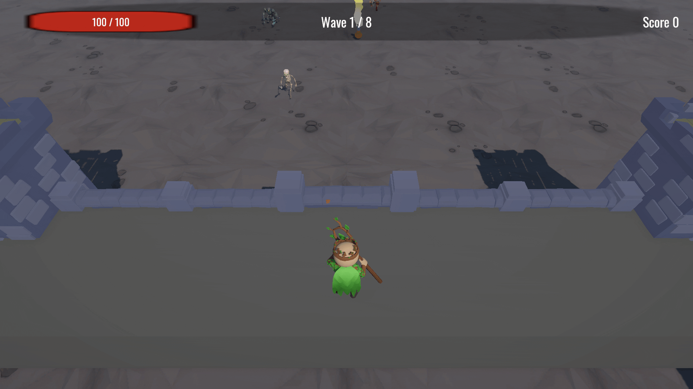
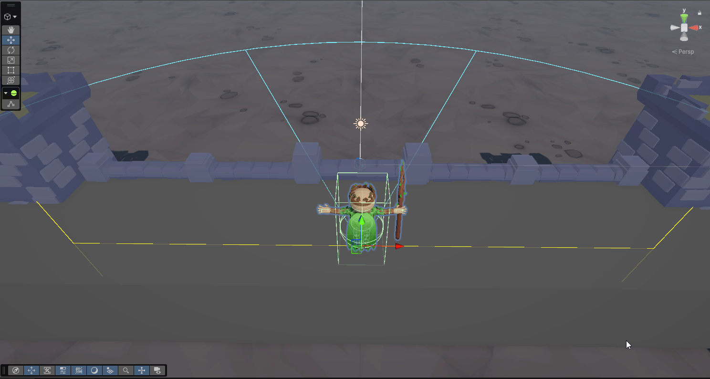

# Castle Mage

**Play in the browser:** [Castle Mage on itch.io](https://kon-koutsioumpas.itch.io/castle-mage)

A short arcade game made in Unity 6. You hold a castle wall. Enemies cross the field. The mage fires on his own, but only at targets inside a range and a forward cone. You move him so the cone covers the threat that matters.

The GIF above is `Docs/gameplay.gif`. The play link is a placeholder until the WebGL build is uploaded.

## Controls

- **Left / Right arrows** move the mage along the rampart. He stays inside the camera frame.
- **Shooting is automatic.** If an enemy is inside the cone, he fires. There is no fire button.
- **Mouse** uses the menu, Retry, and Return to Menu buttons.

## Features

- Eight finite waves. Clearing the last one is a victory. If the castle’s health reaches zero, the run ends.
- Three enemies, tuned as data: a fast skeleton, a slow minotaur, and a spitter that stops and shoots the wall.
- Three power-ups: Rapid Fire, Multi-Shot, and Castle Repair. Timed buffs refresh their duration. They do not stack.
- Score on a kill only. Reaching the wall does not score. The high score is kept between sessions.
- Arrows are reused from a pool instead of being created and destroyed on every shot.

## Architecture

Gameplay code lives in the `CastleArcher` namespace. Components talk through serialized references and C# events. There is no game-manager singleton.

**Health** is one component, used by enemies and by the castle. `TakeDamage` and `Heal` clamp the value. `OnHealthChanged` drives the health bar. `OnDied` fires once. The castle dying ends the run. An enemy dying awards score and plays the death sequence. Colliders turn off immediately, so a corpse cannot still hurt the wall.

**ScriptableObjects** hold the tunable data:

- `EnemyDefinition` — health, speed, castle damage, and score
- `PowerupDefinition` — which effect, how long it lasts, and its colour
- `WaveDefinition` — which enemies spawn, and how many

The spawner applies those numbers after it creates the instance. Changing a wave does not require a code change.

**Targeting** is a cone on the ground plane, about 18 units long and 50 degrees wide. The mage’s root keeps facing the field, so the cone does not swing when he strafes. Among enemies inside the cone, the one closest to the castle (the smallest world Z) is the target. The Scene view draws the range and the cone edges when the mage is selected.

**Event flow.** A wave starts and spawns enemies from their definitions. Targeting publishes the current target. The shooter pulls an arrow from the pool and fires only while that target exists. The arrow damages `Health`. `OnDied` updates the score and plays death. Castle health reaching zero raises game over. Clearing every wave raises victory. The HUD only listens. It does not decide any of this.

## Credits

Models, audio, and effects are third-party packs kept in `Assets/AssetStore` and `Assets/Audio`:

- Castle — Simple Modular Castle Assets (Bublik)
- Mage — Pack Heros
- Skeleton — SazenGames
- Minotaur — minotaur1
- Spitter — Stylized 3D Monster
- Particles — Unity Technologies Particle Pack
- Audio — Music, RPG Audio, and Impact Sounds packs in `Assets/Audio`
